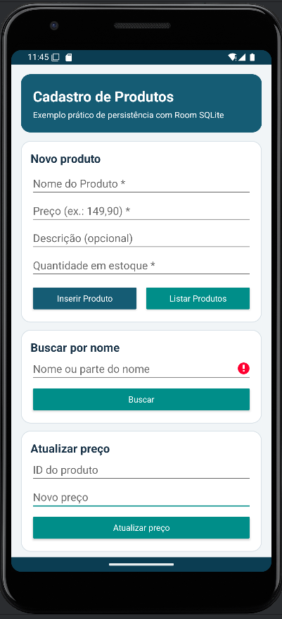
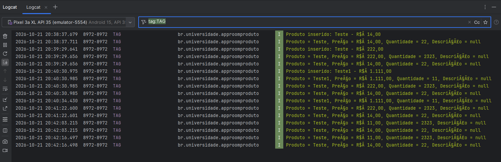
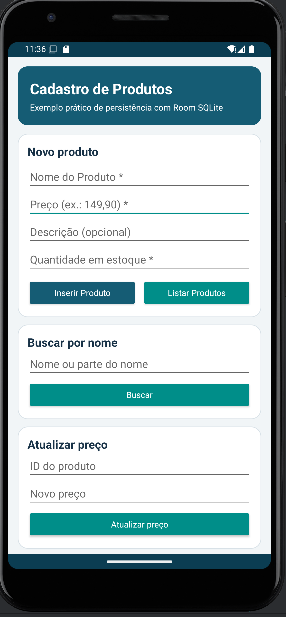
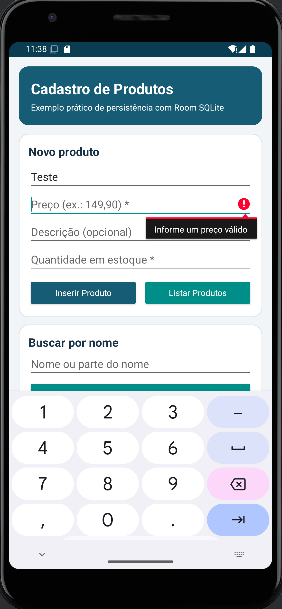
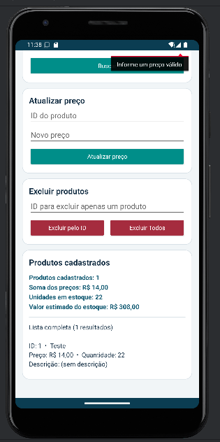
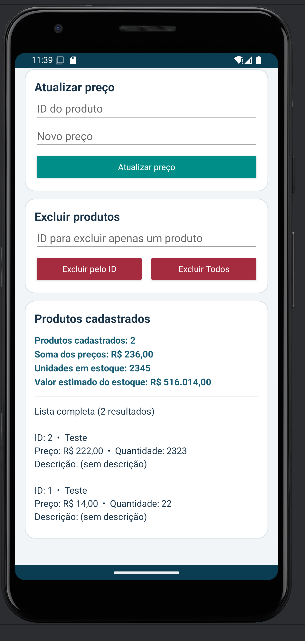
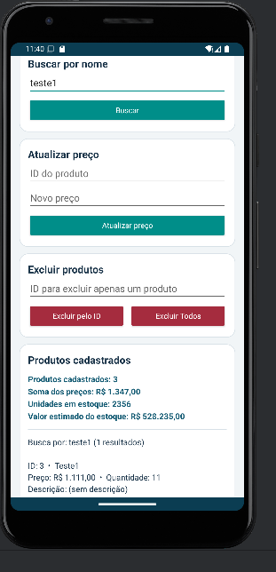
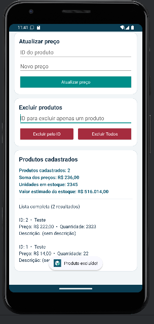
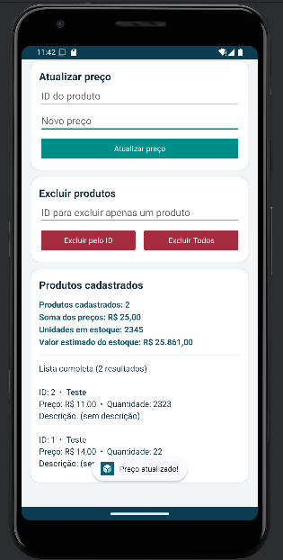
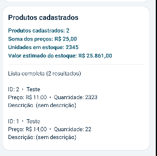

# AppRoomProduto: Cadastro de Produtos com Room SQLite

**Aluno(a):** Lorenzo Norberto 242251, Ahmad Malat 244551
**Disciplina:** Programação para Dispositivos Móveis

## Sobre o projeto

Aplicativo Android desenvolvido em **Kotlin** que cadastra, consulta, busca, atualiza e exclui produtos utilizando persistência local com **Room (SQLite)**. Mesmo depois de fechar e abrir o aplicativo, os dados continuam disponíveis no celular, desde que o banco não seja apagado por uma desinstalação, limpeza de dados ou migração destrutiva. O projeto segue o tutorial da atividade e implementa os oito complementos pedidos na **Parte A**. A tela foi feita com XML e ViewBinding.

## Tecnologias

- Kotlin e Android SDK (mínimo API 24)
- Room **2.6.1** / SQLite
- ViewBinding
- Corrotinas com `lifecycleScope.launch`
- Android Gradle Plugin 8.7.3 e Gradle 8.9
- AppCompat

## Como executar

1. Extraia o ZIP para uma pasta, mantendo todos os arquivos do projeto `AppRoomProduto`.
2. Abra o **Android Studio** e clique em **Open**.
3. Selecione a pasta `AppRoomProduto` (a que contém `settings.gradle.kts`), **não** a pasta `app`.
4. Aguarde o **Gradle Sync** e aceite instalar as dependências ou a plataforma Android SDK 35, se solicitado. É necessária conexão à internet para o primeiro download.
5. Selecione um emulador Android (API 24+) ou um celular com depuração USB ativada.
6. Clique em **Run ▶**. Teste o cadastro de `Teclado`, preço `149,90`, descrição `Teclado USB`, quantidade `3`.
7. Confira a lista dentro do próprio app. Para ver o registro no Logcat, use o filtro `tag:TAG`.
8. Siga os cenários de **[docs/GUIA_TESTES.md](docs/GUIA_TESTES.md)** e substitua as imagens ilustrativas por capturas reais do emulador.

> **Observação importante sobre os prints:** as imagens incluídas em `docs/prints/` estão identificadas como **marcadores ilustrativos**, não são capturas de execução. Como a atividade exige prints obtidos no emulador, é preciso substituí-las pelos prints reais depois de testar o app. O código foi conferido estaticamente, mas sua execução no emulador ainda deve ser confirmada no Android Studio.

## Prints do app





## Parte A: Complemento prático

### A1. Limpar os campos após inserir

**O que foi feito:** quando um produto é gravado com sucesso no Room, o programa esvazia os quatro campos do cadastro (nome, preço, descrição e quantidade) e devolve o cursor ao campo Nome. O campo extra de quantidade também é limpo para não ser reaproveitado sem querer. Essa limpeza ocorre **depois** da inserção terminar, dentro da corrotina.

**Trecho principal (`view/MainActivity.kt`):**

```kotlin
productDao.insertAll(Product(name = nome, price = preco, description = descricao, quantity = quantidade))
binding.editProductName.text?.clear()
binding.editProductPrice.text?.clear()
binding.editProductDescription.text?.clear()
binding.editProductQuantity.text?.clear()
binding.editProductName.requestFocus()
```

**Print A1:** 

### A2. Validação de preço

**O que foi feito:** antes de gravar o produto, converto o preço digitado para `Double`. A função aceita `149.90` e `149,90`, mas impede salvar valor vazio, letras, zero e valores negativos. O aviso é exibido no próprio campo com a propriedade `error`. A validação também impede valores não finitos.

**Trecho principal (`view/MainActivity.kt`):**

```kotlin
val preco = converterPreco(binding.editProductPrice.text.toString())
if (preco == null || !preco.isFinite() || preco <= 0.0) {
    binding.editProductPrice.error = "Informe um preço válido"
    binding.editProductPrice.requestFocus()
    return
}
```

**Print A2:** 

### A3. Lista de produtos na tela

**O que foi feito:** adicionei o `TextView` chamado `txtListaProdutos` abaixo dos controles do app. Ao clicar em **Listar Produtos**, o aplicativo consulta o DAO e mostra os produtos com ID, nome, preço, quantidade e descrição. O Logcat continua recebendo os registros para ajudar na conferência.

**Trecho principal (`view/MainActivity.kt`):**

```kotlin
private fun listarProdutos() {
    lifecycleScope.launch {
        val produtos = productDao.getAll()
        mostrarProdutos(produtos, produtos, "Lista completa")
    }
}

binding.txtListaProdutos.text = exibidos.joinToString("\n\n") { produto ->
    "ID: ${produto.id} - ${produto.name} - ${moeda.format(produto.price)}"
}
```

O trecho do `TextView` acima resume a lógica utilizada dentro de `mostrarProdutos`, que também formata a quantidade e a descrição.

**Print A3:** 

### A4. Total do estoque

**O que foi feito:** acima da lista, o `TextView` `txtResumoEstoque` apresenta a **quantidade de produtos cadastrados** e a **soma dos preços**, exatamente como solicitado. Como agora cada produto também possui quantidade em estoque, exibo adicionalmente a soma das unidades e o valor estimado do estoque (`preço × quantidade`). Ao pesquisar por um nome, o resumo continua representando **todo o cadastro**, não apenas os itens filtrados.

**Trecho principal (`view/MainActivity.kt`):**

```kotlin
val totalProdutos = todos.size
val somaDosPrecos = todos.sumOf { it.price }
val unidades = todos.sumOf { it.quantity }
val valorEmEstoque = todos.sumOf { it.price * it.quantity }
```

**Print A4:** 

### A5. Buscar por nome

**O que foi feito:** criei um campo para digitar o nome e o botão **Buscar**. O método `buscarPorNome()` no DAO usa `LIKE` e recebe o texto com `%` dos dois lados. Assim, buscar por `tec` pode encontrar `Teclado`, mesmo sem digitar a palavra inteira.

**Trechos principais (`dao/ProductDao.kt` e `view/MainActivity.kt`):**

```kotlin
@Query("SELECT * FROM product WHERE name LIKE :nome ORDER BY id DESC")
suspend fun buscarPorNome(nome: String): List<Product>

// Dentro de buscarProdutos(), na corrotina:
val encontrados = productDao.buscarPorNome("%$texto%")
```

**Print A5:** 

### A6. Excluir produtos

**O que foi feito:** adicionei o botão **Excluir Todos**, que exibe uma janela de confirmação antes de remover os registros do banco. Também implementei o desafio extra de excluir um produto específico pelo **ID**, usando a anotação `@Delete` do Room. Após a exclusão, a lista e o resumo são atualizados.

**Trechos principais (`dao/ProductDao.kt` e `view/MainActivity.kt`):**

```kotlin
@Query("DELETE FROM product")
suspend fun deleteAll()

@Delete
suspend fun delete(product: Product): Int

// Após confirmação pelo usuário:
lifecycleScope.launch {
    productDao.deleteAll()
    listarProdutos()
}
```

**Print A6:** 

### A7. Atualizar o preço de um produto

**O que foi feito:** incluí os campos **ID do produto** e **Novo preço**, além do botão **Atualizar preço**. O aplicativo procura o cadastro pelo ID, confere se o preço é válido e chama a função com `@Update` para salvar o novo valor. O uso de `copy()` preserva os dados que não foram modificados.

**Trechos principais (`dao/ProductDao.kt` e `view/MainActivity.kt`):**

```kotlin
@Query("SELECT * FROM product WHERE id = :id LIMIT 1")
suspend fun buscarPorId(id: Int): Product?

@Update
suspend fun update(product: Product): Int

// Dentro de atualizarPreco(), na corrotina:
val atual = productDao.buscarPorId(id)
if (atual != null) productDao.update(atual.copy(price = novoPreco))
```

**Print A7:** 

### A8. Novo campo na tabela: quantidade

**O que foi feito:** adicionei o atributo `quantity: Int` à entidade `Product`, incluí o campo **Quantidade em estoque** na tela e aumentei a versão do banco para `2`. O cadastro exige uma quantidade inteira igual ou superior a zero. A listagem e os totais também consideram a quantidade.

**Trechos principais (`model/Product.kt` e `db/AppDatabase.kt`):**

```kotlin
@ColumnInfo(name = "quantity") val quantity: Int = 0

@Database(entities = [Product::class], version = 2, exportSchema = false)
abstract class AppDatabase : RoomDatabase() { /* ... */ }

// No construtor do banco:
.fallbackToDestructiveMigration()
```

**O que acontece com os produtos antigos e por quê?** Se um usuário instalar essa versão sobre a versão 1 do tutorial **com o mesmo banco (`database-name`)**, o Room perceberá a mudança do esquema. Como o exercício utiliza `fallbackToDestructiveMigration()` e **não** implementa uma migração da versão 1 para a 2, a tabela antiga é recriada e os produtos cadastrados anteriormente são **perdidos**. Os novos cadastros da versão 2 continuam salvos ao fechar e reabrir o aplicativo. Em um sistema real, seria melhor criar uma `Migration(1, 2)` usando `ALTER TABLE` para adicionar a coluna e preservar os registros.

**Print A8:** 

## Parte B: Questões dissertativas

### B1. O que é persistência de dados? O que aconteceria com uma `MutableList`?

Persistência de dados é a capacidade de guardar informações para que elas continuem disponíveis depois que o aplicativo é fechado ou o dispositivo é reiniciado. Neste projeto, isso acontece porque o Room armazena os produtos em um banco SQLite no celular. Quando abro o aplicativo de novo, o método `getAll()` consegue consultar os registros gravados antes. Se eu usasse apenas uma `MutableList` dentro da `MainActivity`, os dados ficariam somente na memória durante a execução do aplicativo. Quando o processo fosse encerrado, a lista seria perdida e teria que ser criada novamente. Por isso, uma lista em memória pode ajudar a exibir dados temporários, mas não substitui a persistência para um cadastro de produtos.

### B2. Qual é a diferença entre SQLite direto e Room? Dê duas vantagens.

O SQLite é o banco de dados que realmente armazena as informações no Android. Se eu trabalhasse diretamente com ele, usando `SQLiteOpenHelper`, precisaria cuidar manualmente da criação das tabelas, da execução dos comandos SQL e da conversão dos resultados para objetos Kotlin. O Room funciona como uma camada que organiza essas operações e facilita o acesso ao SQLite. Uma vantagem é que consigo representar a tabela usando a classe `Product` com `@Entity`, sem precisar montar todo o código de conversão de cada resultado. Outra vantagem é que as consultas declaradas no `ProductDao` são verificadas pelo Room durante a compilação, ajudando a encontrar erros mais cedo. Além disso, o Room se integra bem com corrotinas e separa melhor as responsabilidades do projeto.

### B3. Explique o papel de `Entity`, `DAO` e `Database`.

No meu projeto, a **Entity** é a classe `Product`, responsável por definir como um produto é armazenado no banco. Ela possui os atributos `id`, `name`, `price`, `description` e `quantity`, que correspondem às colunas da tabela. O **DAO**, representado pela interface `ProductDao`, contém as operações de inserir, listar, buscar, atualizar e excluir produtos. Já a classe `AppDatabase`, anotada com `@Database`, configura o banco Room, informa quais entidades fazem parte dele e oferece acesso ao DAO. Essas três peças trabalham juntas: a tela solicita uma ação ao `ProductDao`, o Room executa a operação no banco configurado em `AppDatabase` e os resultados voltam na forma de objetos `Product`. Essa divisão deixa o código mais fácil de entender e modificar.

### B4. Por que não acessar o banco na thread principal? O que é ANR?

A thread principal do Android é responsável por desenhar a tela e responder aos toques do usuário. Se uma consulta ou gravação no banco demorar e for executada de forma bloqueante nessa thread, os botões podem parar de responder e a interface pode ficar congelada. Quando um aplicativo não responde dentro do tempo esperado, o Android pode apresentar um aviso chamado **ANR**, sigla de *Application Not Responding*. Para evitar esse problema, os métodos de acesso ao banco no meu DAO usam `suspend`, permitindo que o Room execute o trabalho de banco sem bloquear a interface. Na `MainActivity`, aciono esses métodos dentro de `lifecycleScope.launch`, que cria uma corrotina associada ao ciclo de vida da tela. Assim, o acesso é feito de maneira assíncrona e a interface continua responsiva.

### B5. O que é `fallbackToDestructiveMigration()`? O que seria `Migration`?

O método `fallbackToDestructiveMigration()` permite que o Room recrie as tabelas quando encontra uma mudança de versão do banco para a qual não existe um caminho de migração. Isso é prático em exercícios, porque evita ter que escrever uma migração toda vez que a estrutura muda. O problema é que essa reconstrução pode **apagar os dados antigos**, como aconteceria ao passar da versão 1 para a 2 deste projeto. Em um aplicativo de verdade, publicado na Play Store, perder o estoque ou outros cadastros de clientes seria muito grave. Uma **Migration** é um conjunto de instruções que transforma o banco antigo no novo formato, preservando os registros existentes. No caso da nova coluna `quantity`, uma migração poderia acrescentar a coluna à tabela com um valor padrão, sem destruir os produtos já salvos.

### B6. Qual a vantagem do ViewBinding sobre `findViewById`?

O ViewBinding facilita a ligação entre os componentes escritos no XML e o código Kotlin da tela. Antes, usando `findViewById`, eu precisaria procurar cada campo pelo seu ID e garantir manualmente que o tipo informado era o correto. Com o ViewBinding, o Android gera a classe `ActivityMainBinding`, que oferece propriedades como `binding.editProductName` e `binding.btnBuscar`. Isso deixa o código menor e mais fácil de ler, especialmente quando existem vários campos e botões. Outra vantagem é a verificação de tipos durante a compilação, que ajuda a evitar erros de associação de uma view com o tipo errado. Ele também reduz problemas com referências a IDs inexistentes, que ficariam mais difíceis de perceber quando se usa `findViewById` manualmente.

### B7. Por que usar um banco Singleton em apps maiores?

Em aplicativos maiores, várias telas podem precisar ler e alterar os mesmos dados. Se cada tela criar sua própria instância do Room, o programa pode acabar abrindo conexões e mantendo recursos desnecessários, além de complicar a organização do acesso ao banco. Uma abordagem mais segura é compartilhar uma única instância da classe de banco durante o funcionamento do aplicativo, usando o padrão **Singleton**. Por isso, adaptei a classe `AppDatabase` para oferecer `getInstance(context)` e guardar a referência no campo `INSTANCE`. A anotação `@Volatile` e o bloco `synchronized` ajudam a evitar a criação simultânea de duas instâncias. Dessa forma, tanto a tela atual quanto outras telas que sejam adicionadas poderão usar o mesmo banco de maneira centralizada.

### B8. Reflexão pessoal: dificuldades e exemplo de aplicativo real

Uma das partes que exige mais atenção neste exercício é conectar corretamente a interface XML ao Kotlin, porque cada botão e campo precisa ter um ID correspondente no ViewBinding. Outro cuidado importante é validar os valores antes de gravar, principalmente o preço, que pode ser digitado com vírgula, e a quantidade, que não deve ser negativa. Também é necessário entender a diferença entre atualizar a tela e salvar os dados definitivamente no banco. Para organizar isso, o código separa as operações em funções como `inserirProduto()`, `buscarProdutos()` e `atualizarPreco()`, enquanto o DAO concentra os comandos de banco. Um exemplo de uso real seria um aplicativo de estoque para uma loja de ferragens: ele poderia funcionar sem internet, guardando nome, preço e quantidade dos produtos no próprio celular. Quando o usuário reabrisse o app, as informações ainda estariam disponíveis para consultar e atualizar. **Esta resposta descreve as dificuldades esperadas pelo código; após seus testes, ajuste o texto para refletir o que você realmente vivenciou.**

## Estrutura principal

```text
AppRoomProduto/
├── app/
│   ├── build.gradle.kts
│   └── src/main/
│       ├── java/br/universidade/approomproduto/
│       │   ├── model/Product.kt
│       │   ├── dao/ProductDao.kt
│       │   ├── db/AppDatabase.kt
│       │   └── view/MainActivity.kt
│       ├── res/layout/activity_main.xml
│       └── AndroidManifest.xml
├── docs/
│   ├── GUIA_TESTES.md
│   └── prints/
│       ├── tela-inicial.png
│       ├── logcat.png
│       └── a1.png ... a8.png
├── gradle/wrapper/
├── README.md
└── settings.gradle.kts
```

## Publicação no GitHub

1. No Android Studio, abra a pasta raiz e conecte sua conta em **Settings > Version Control > GitHub**.
2. Vá a **Git > GitHub > Share Project on GitHub** (ou equivalente na sua versão).
3. Use o nome `AppRoomProduto`, configure o repositório como **público** e inclua os arquivos do projeto, README e prints reais.
4. Confira na página do GitHub se as imagens e as respostas aparecem corretamente.
5. Envie ao professor **o link público do repositório**, não apenas o arquivo ZIP.

Alternativa no Terminal, após criar um repositório público vazio `AppRoomProduto` no GitHub:

```bash
git init
git add .
git commit -m "Implementa atividade Room SQLite com complementos A1 a A8"
git branch -M main
git remote add origin https://github.com/SEU-USUARIO/AppRoomProduto.git
git push -u origin main
```

